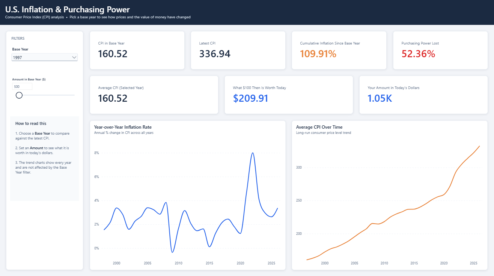
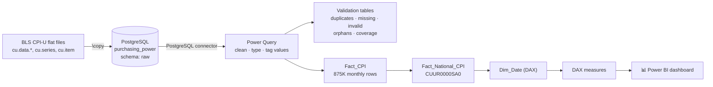

<div align="center">

# 📉 U.S. Inflation & Purchasing Power Dashboard

**How much is a dollar from any year since 1997 worth today?**
An end-to-end analytics project: raw government CPI data → **PostgreSQL** → **Power Query** validation → **Power BI** star schema and DAX.


</div>


<p align="center"><sub>Base year 1997 · $500 converted to today's dollars · CPI data through Sep 2026</sub></p>

---

## 📌 The question

Everyone feels inflation at the checkout, but few people can put a number on it.
This dashboard answers three practical questions:

1. **How much have prices risen** since a year I choose?
2. **How much purchasing power** has a dollar from that year lost?
3. **What is a specific amount** (e.g. a 2005 salary or a 1997 rent) **worth in today's dollars?**

## 💡 Key findings

| | Finding |
|---|---|
| 💵 | **$100 in 1997 ≈ $210 in Sep 2026.** Prices have more than doubled in under 30 years. |
| 📉 | A 1997 dollar has lost **52.4%** of its purchasing power. |
| 🔥 | **2022 was the peak:** average CPI rose **8.0%** year over year, after 4.7% in 2021. |
| 🧊 | **2009 is the only year prices fell (−0.4%)**, during the financial crisis. |
| ⏳ | Even a **2020 dollar** has lost about **23%** of its value. |
| 🔎 | **October 2025 CPI is missing** for 2,753 series: BLS did not publish that month (footnote `X`). The pipeline flags it instead of filling it in. |

*Based on CPI-U, all items, U.S. city average, not seasonally adjusted (series `CUUR0000SA0`), Jan 1997 – Sep 2026. 2026 is a partial year.*

## 🖥️ Dashboard features

- **Base Year slicer** – every KPI recalculates against the year you choose.
- **What-if amount slider** ($0–$10,000) – converts any amount into today's dollars.
- **KPI cards** – CPI in base year, latest CPI, cumulative inflation, purchasing power lost, value of $100 today, your amount today.
- **Trend charts** – year-over-year inflation rate and average CPI over time, with **drill-down Year → Quarter → Month**. They ignore the Base Year filter so the full history is always visible.
- **Guided layout** – a "How to read this" panel so a non-technical reader can use it straight away.

## 🏗️ Architecture



### 1. PostgreSQL: staging the raw data
The five BLS CPI-U files are loaded **unchanged** into a `raw` schema in a local `purchasing_power` database.
Observation values are kept as `TEXT` on purpose: BLS writes `-` for months it did not publish, and a numeric column would either reject the load or hide that fact.

| Table | Source file | Rows | Contents |
|---|---|---:|---|
| `raw.cpi_current` | `cu.data.0.Current` | 1,170,617 | All series, recent years |
| `raw.cpi_data` | `cu.data.1.AllItems` | 64,064 | "All items" series back to 1913 |
| `raw.cpi_summaries` | `cu.data.2.Summaries` | 287,323 | Headline summary series |
| `raw.cpi_series` | `cu.series` | 8,104 | Series catalogue (area, item, seasonal flag, title) |
| `raw.cpi_item` | `cu.item` | 400 | Item / category names |

Scripts: [`sql/`](sql)

### 2. Power Query: cleaning
- Connects to PostgreSQL (`localhost:5432`, database `purchasing_power`).
- Tags every observation as **Valid / Missing / Invalid** and converts text to numbers safely (`try … otherwise null`).
- Drops `M13` (annual average) rows and builds a real **monthly Date** from `year` + `period`.
- Joins the series catalogue to add area, item and seasonal flags → **`Fact_CPI`** (875,488 rows).
- Filters to all items / U.S. city average / unadjusted → **`Fact_National_CPI`** (357 months).

Every query is in [`power-query/`](power-query).

### 3. Data quality checks
Each check is its own table in the model, so it refreshes with the data:

| Check | Result |
|---|---|
| Duplicate series-month rows | ✅ 0 |
| Invalid values (non-numeric or ≤ 0) | ✅ 0 |
| Observations without a matching series | ✅ 0 |
| Missing values | ⚠️ 2,753, all Oct 2025 (not published by BLS) |
| National series coverage | ✅ 357 consecutive months, Jan 1997 – Sep 2026 |
| Seasonal split | 7,778 unadjusted · 326 adjusted series |

SQL equivalents of these checks: [`sql/04_data_quality_checks.sql`](sql/04_data_quality_checks.sql). More detail: [`docs/data-quality.md`](docs/data-quality.md).

### 4. Data model & DAX
`Fact_National_CPI` → `Dim_Date` (calculated with `CALENDAR`), plus a `Historical Amount` what-if table (`GENERATESERIES(0, 10000, 100)`).

| Measure | What it does |
|---|---|
| `Latest CPI` | CPI of the most recent month, ignoring date filters |
| `Historical CPI` | Average CPI of the selected base year |
| `Cumulative Inflation %` | `(Latest − Historical) / Historical` |
| `Purchasing Power Lost %` | `1 − Historical / Latest` |
| `Value of $100 Today` | `100 × Latest / Historical` |
| `Adjusted Amount Today` | Selected amount × `Latest / Historical` |
| `YoY Inflation %` | Annual average vs. `SAMEPERIODLASTYEAR` |
| `Average CPI (No Year Filter)` | Keeps trend charts showing every year |

All formulas: [`dax/measures.dax`](dax/measures.dax). Field-level detail: [`docs/data-dictionary.md`](docs/data-dictionary.md).

## 🚀 Run it yourself

**Just explore the dashboard:** download [`powerbi/US_Inflation_Purchasing_Power.pbix`](powerbi/US_Inflation_Purchasing_Power.pbix) and open it in [Power BI Desktop](https://powerbi.microsoft.com/desktop/) (free). The data is already imported, so no database is needed.

**Rebuild from scratch:**
1. Install PostgreSQL and download the five files from <https://download.bls.gov/pub/time.series/cu/>.
2. Run the SQL scripts in order:
   ```bash
   psql -U postgres -f sql/01_create_database_and_schema.sql
   psql -U postgres -d purchasing_power -f sql/02_create_raw_tables.sql
   psql -U postgres -d purchasing_power -f sql/03_load_bls_files.sql
   ```
3. Open the `.pbix`, go to **Transform data → Data source settings**, point it at your PostgreSQL server and click **Refresh**.

## 📁 Repository structure

```
├── powerbi/
│   └── US_Inflation_Purchasing_Power.pbix   # the dashboard
├── sql/
│   ├── 01_create_database_and_schema.sql
│   ├── 02_create_raw_tables.sql
│   ├── 03_load_bls_files.sql
│   └── 04_data_quality_checks.sql
├── power-query/                              # every M query in the model
├── dax/
│   └── measures.dax                          # calculated tables + measures
├── docs/
│   ├── data-dictionary.md
│   └── data-quality.md
└── images/                                   # dashboard screenshots
```

## 🧰 Skills demonstrated
`PostgreSQL` · `SQL data loading & validation` · `Power Query (M)` · `Data cleaning` · `Data quality testing` · `Star schema modelling` · `DAX (time intelligence, CALCULATE, what-if parameters)` · `Dashboard design` · `Economic data analysis`

## 📚 Data source
U.S. Bureau of Labor Statistics, Consumer Price Index for All Urban Consumers (CPI-U), <https://www.bls.gov/cpi/>. BLS data is in the public domain.

## 👤 Author
**Rajeev Varma** · [GitHub](https://github.com/Rajeevvarma2001)

If this project helped you, consider giving it a ⭐.
